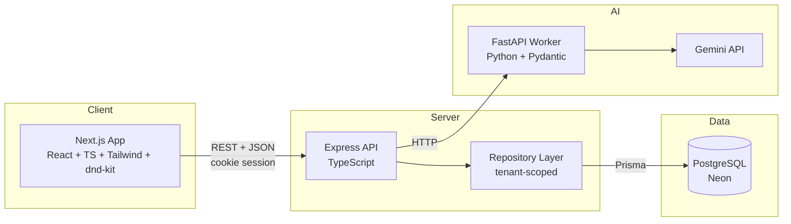
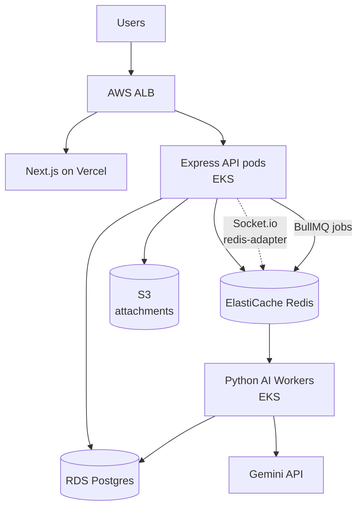
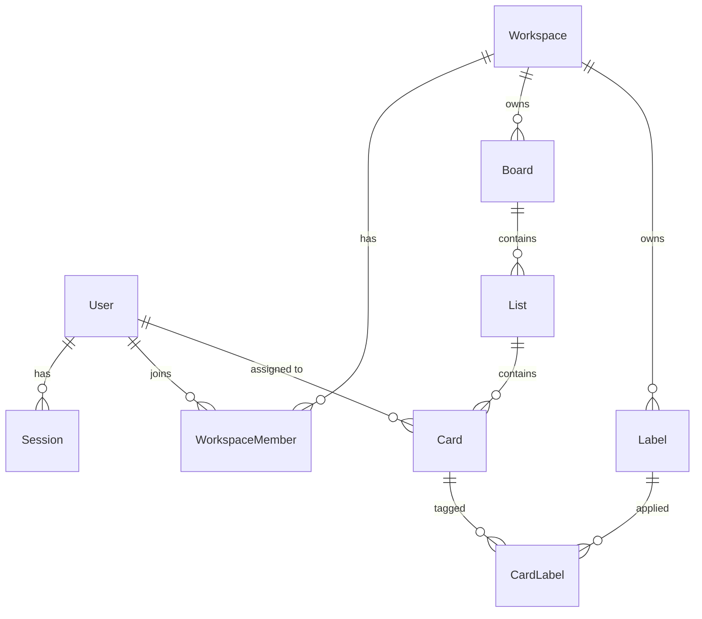

# Kolumna — Architecture & Tech Stack

> A multi-tenant, AI-assisted project board. Trello's core concept, with workspace
> isolation and LLM features built in from the data model up.

This document explains **what we are building and why each piece exists**. It is meant
to be read once at the start and referred back to whenever you're unsure why something
is structured the way it is.

---

## 1. Guiding principles

These four rules decide every argument in this project.

1. **Ship the boring core first.** A board that works beats a cluster that scales.
2. **Only pay complexity for a problem you actually have.** Kubernetes solves a problem
   we do not have at zero users. It gets added later, deliberately, as a learning
   exercise — not as part of the product.
3. **Make correctness structural, not remembered.** Tenant isolation should be
   impossible to forget, not something you have to remember 200 times.
4. **Decide the expensive things early.** Data model and ordering strategy are painful
   to change later. Deployment target is not. So we sweat the schema and defer the infra.

---

## 2. System architecture

### 2.1 MVP architecture (what we build in weeks 1–3)



Three processes. That's it. No message broker, no containers, no orchestrator.

### 2.2 Target architecture (Phase 4+, after the MVP ships)



The MVP architecture grows into this **without rewrites**, because the seams — repository
layer, separate API service, isolated AI service — are already in place.

---

## 3. Tech stack

### 3.1 MVP stack (locked)

| Layer | Choice | Why this one |
|---|---|---|
| Framework | **Next.js (App Router) + TypeScript** | Routing, SSR, and file-based structure out of the box. TS catches your mistakes at compile time, which matters a lot when you're learning. |
| Styling | **Tailwind CSS** | No context-switching to CSS files, no naming things. Fastest path to a UI that doesn't look like 1998. |
| Drag & drop | **dnd-kit** | Modern, accessible, unopinionated. The maintained choice for this job. |
| API | **Express + TypeScript** | Small, unmagical, extremely well documented. You will understand every line, which is the point on a first project. |
| Database | **PostgreSQL (Neon)** | Relational data with real foreign keys. Neon's free tier means zero local setup. |
| ORM | **Prisma** | Typed queries generated from your schema, readable migrations, great error messages. |
| Auth | **Lucia** (or Auth.js) | Session management done correctly. Hand-rolled JWT is the #1 source of security bugs in first projects. |
| AI service | **Python + FastAPI + Pydantic v2** | Pydantic forces the LLM to return structured, validated JSON instead of hopeful string parsing. |
| LLM | **Gemini API** | Generous free tier, good structured-output support. |
| Package manager | **Bun** | Much faster installs than npm. Changes nothing about how code runs — pure upside. |
| Unit/integration tests | **Vitest** | One assertion and mocking API across frontend and backend. |
| E2E tests | **Playwright** | Has its own runner by design. One real browser test is worth twenty unit tests here. |
| Hosting | **Vercel** (web) + **Railway** (api) + **Neon** (db) | Free, and deploys in minutes instead of days. |

### 3.2 Deliberately deferred

| Deferred | Arrives in | Why not now |
|---|---|---|
| Socket.io real-time | Phase 4 | The app is fully usable without it. Adds state-sync complexity to every feature. |
| Redis | Phase 4 | Only needed once you have multiple API instances or a real job queue. |
| Docker | Phase 4 | Neon removes the need for a local database container — the main reason a beginner reaches for Docker. |
| Kubernetes / EKS | Phase 5 | Solves problems we do not have. Learn it *after* you have something to deploy on it. |
| Ansible | **Cut entirely** | Overlaps with Docker + K8s and configures VMs we aren't using. Résumé keyword, not architecture. |
| S3 attachments | Phase 4 | Not in MVP scope. |
| pgvector dedupe | Phase 4 | Needs embeddings infrastructure; the epic decomposer is a better first AI feature. |

---

## 4. Repository structure

A monorepo, so frontend and backend share TypeScript types and never drift apart.

```
kolumna/
├── apps/
│   ├── web/                    # Next.js frontend
│   │   ├── app/
│   │   │   ├── (auth)/         # login, signup
│   │   │   ├── (app)/          # authenticated app shell
│   │   │   │   └── b/[boardId]/
│   │   │   └── layout.tsx
│   │   ├── components/
│   │   ├── lib/api-client.ts   # single place that talks to the API
│   │   └── ...
│   │
│   └── api/                    # Express backend
│       ├── src/
│       │   ├── routes/         # HTTP layer — parse, validate, respond
│       │   ├── repositories/   # data layer — ALL Prisma access lives here
│       │   ├── services/       # business logic (ranking, permissions)
│       │   ├── middleware/     # auth, tenant context, error handling
│       │   ├── lib/
│       │   └── index.ts
│       ├── prisma/
│       │   ├── schema.prisma
│       │   └── seed.ts
│       └── tests/
│
├── services/
│   └── ai/                     # Python FastAPI worker
│       ├── main.py
│       ├── schemas.py          # Pydantic models
│       └── prompts/
│
├── packages/
│   └── shared/                 # types shared by web + api
│       └── src/types.ts
│
├── ARCHITECTURE.md
├── ROADMAP.md
└── package.json
```

**The rule that matters:** `routes/` never imports Prisma. Only `repositories/` does.
This is what makes tenant isolation structural instead of a habit.

---

## 5. Data model



### 5.1 Core tables

| Table | Purpose | Key fields |
|---|---|---|
| `User` | A person | `id`, `email`, `hashedPassword`, `name` |
| `Session` | Login session | `id`, `userId`, `expiresAt` |
| `Workspace` | **The tenant boundary** | `id`, `name`, `slug` |
| `WorkspaceMember` | Who can see a workspace | `workspaceId`, `userId`, `role` |
| `Board` | A board | `id`, `workspaceId`, `title` |
| `List` | A column | `id`, `boardId`, `workspaceId`, `title`, `rank` |
| `Card` | A card | `id`, `listId`, `workspaceId`, `title`, `description`, `rank`, `dueDate`, `assigneeId` |
| `Label` | A colored tag | `id`, `workspaceId`, `name`, `color` |
| `CardLabel` | Join table | `cardId`, `labelId` |

### 5.2 Why `workspaceId` is denormalized onto `List` and `Card`

Strictly, you could reach a card's workspace by joining `Card → List → Board → Workspace`.
We store it directly instead.

**Reason:** every single query can then filter by tenant with one `WHERE` clause and no
joins. It makes the isolation rule trivially enforceable and uniformly applied. The cost
is that you must set it correctly on insert — which the repository layer does for you.

This is a deliberate trade of normalization purity for security simplicity. Take it.

---

## 6. Key design decisions

### Decision 1 — Multi-tenancy: shared database, shared schema

Every tenant's data lives in the same tables, separated by `workspaceId`.

**Alternatives rejected:** database-per-tenant (operationally heavy, terrible at low
scale), schema-per-tenant (migration nightmare).

**The risk:** one forgotten `WHERE workspaceId = ?` leaks another tenant's data. Silent,
severe, and easy to do.

**Two defenses:**
1. Route handlers never touch Prisma. Every repository function takes tenant context as a
   **required first argument**, so the type system won't let you forget it.
2. An integration test, written on day 3 and run in CI forever, that creates two
   workspaces and asserts A cannot read B's boards, lists, or cards.

### Decision 2 — Card ordering: fractional ranking

This is *the* classic Trello-clone trap and the most likely place to lose a weekend.

**The naive approach:** `position` as an integer, renumber everything after each move.
That's an O(n) write per drag and it corrupts when two people drag at once.

**What we do:** `rank` is a `Float`. To place a card between two neighbors, take the
midpoint.

```
Cards at rank 1.0, 2.0, 3.0
Drop between the 1st and 2nd → new rank = (1.0 + 2.0) / 2 = 1.5
```

**One write per move**, regardless of list size.

**The catch:** repeated midpoints eventually exhaust float precision (~50 splits in the
same gap). Handle it with a rebalance — when the gap between neighbors gets too small,
renumber the list to `1.0, 2.0, 3.0, …` in one transaction. Rare in practice; write the
function once and forget it.

*(A production system would use a lexicographic rank string like LexoRank. Floats are the
right call here — same behavior, a fraction of the complexity to implement.)*

### Decision 3 — Separate Express API instead of Next.js route handlers

**Cost:** two servers, two deploy targets, some duplicated setup.

**Why we accept it:** real-time WebSockets in Phase 4 need a persistent server process,
which serverless Next.js route handlers don't give you cleanly. A clean frontend/backend
split is also easier to reason about while learning, and easier to talk about later.

Shared types in `packages/shared` stop the two sides from drifting.

### Decision 4 — Sessions, not hand-rolled JWT

JWT in `localStorage` is the classic first-project security bug (XSS reads it, and you
can't revoke it). Lucia gives you httpOnly cookie sessions, server-side revocation, and
proper password hashing without you designing an auth system on your first project.

### Decision 5 — Python for AI, honestly justified

The usual justification — "offload heavy LLM work from the main thread" — **is wrong**.
Calling Gemini is I/O-bound; `await fetch()` doesn't block Node's event loop, so there is
nothing to offload.

The real reasons to keep the Python service:
1. **Pydantic v2** genuinely is the best tool for forcing an LLM into validated,
   structured JSON — which is what stops malformed AI output from corrupting your database.
2. It's a clean, defensible polyglot service boundary and a thing worth having built.

That's an honest case. The fake one would not survive an interview question.

### Decision 6 — Why no Docker or Kubernetes in the MVP

Docker's main draw for a beginner is running Postgres locally. Neon removes that need
entirely. Kubernetes orchestrates containers you don't have yet, for traffic you don't
have yet.

Both arrive in Phase 4/5 as **deliberate learning exercises against a working product** —
which is both faster and far more instructive than configuring infrastructure for an app
that doesn't exist.

---

## 7. API surface (MVP)

```
POST   /auth/signup
POST   /auth/login
POST   /auth/logout
GET    /auth/me

GET    /workspaces
POST   /workspaces
GET    /workspaces/:id/members
POST   /workspaces/:id/members

GET    /workspaces/:wsId/boards
POST   /workspaces/:wsId/boards
GET    /boards/:id                 # returns board + lists + cards, fully hydrated
PATCH  /boards/:id
DELETE /boards/:id

POST   /boards/:id/lists
PATCH  /lists/:id                  # rename
PATCH  /lists/:id/move             # { beforeId, afterId } → computes rank
DELETE /lists/:id

POST   /lists/:id/cards
GET    /cards/:id
PATCH  /cards/:id
PATCH  /cards/:id/move             # { listId, beforeId, afterId } → computes rank
DELETE /cards/:id

POST   /ai/decompose                # { cardId } → subtask suggestions
```

**Note on the move endpoints:** the client sends *neighbors*, not a computed rank. The
server owns ranking. Never let the client send a rank — that's how you get corruption.

---

## 8. Security checklist (MVP)

- [ ] Passwords hashed with Argon2 or bcrypt — never stored or logged in plaintext
- [ ] Session cookies: `httpOnly`, `secure`, `sameSite=lax`
- [ ] Every repository function requires tenant context
- [ ] Tenant isolation integration test passing in CI
- [ ] All request bodies validated with Zod before reaching business logic
- [ ] Secrets in `.env`, `.env` in `.gitignore`, `.env.example` committed
- [ ] CORS restricted to the known frontend origin
- [ ] Rate limit on `/auth/*` and `/ai/*`

---

## 9. Glossary

| Term | Meaning |
|---|---|
| **Tenant** | One customer's isolated data. Here, a Workspace. |
| **Multi-tenant** | One running app serving many tenants, keeping their data separate. |
| **Fractional ranking** | Ordering by decimal values so inserts touch one row instead of many. |
| **Repository layer** | The only code allowed to query the database. Everything else calls it. |
| **Optimistic update** | Update the UI immediately, before the server confirms; roll back on failure. |
| **Monorepo** | One git repo holding several apps/packages that share code. |
| **ORM** | Maps database rows to typed objects. Prisma, here. |

---

## 10. Where this goes next

Once the MVP is live:

- **Phase 4 — Real-time & scale:** Socket.io + `@socket.io/redis-adapter`, BullMQ job
  queue, pgvector duplicate detection, S3 attachments, Docker Compose, GitHub Actions CI.
- **Phase 5 — Infrastructure:** Kubernetes locally with kind/minikube first, then EKS,
  RDS, ElastiCache, ALB.

Nothing in Phase 4 or 5 requires rewriting Phase 1–3. That is the entire point of
building it in this order.
