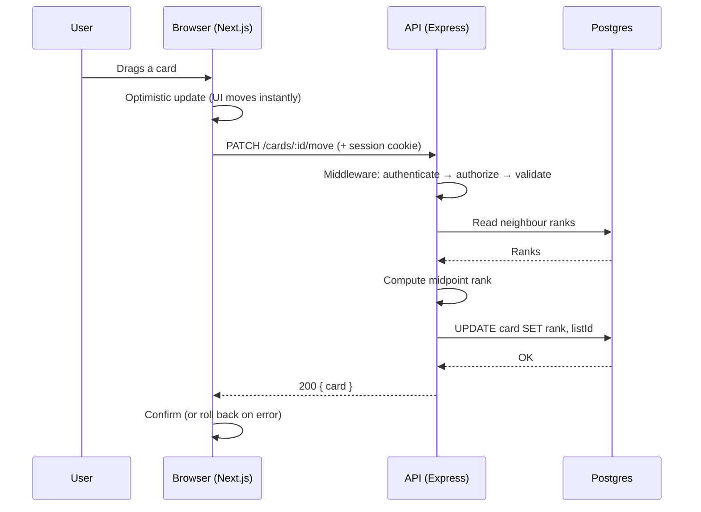

# Kolumna — Concepts, Theory & Terminology

> Every system design concept, every piece of the stack, and every term you'll meet while
> building this project — explained, with the reason it exists and where it shows up in
> Kolumna specifically.

**How to use this:** don't read it front to back. Read Part 1 and Part 4 before Day 1, then
look things up as the roadmap hits them. Each entry follows the same shape:

- **What it is** — the definition
- **Why it exists** — the problem it solves
- **In Kolumna** — where you'll actually touch it

---

## Table of contents

1. [Architecture fundamentals](#part-1--architecture-fundamentals)
2. [The web layer](#part-2--the-web-layer)
3. [Databases & data modeling](#part-3--databases--data-modeling)
4. [Multi-tenancy](#part-4--multi-tenancy)
5. [Authentication & security](#part-5--authentication--security)
6. [Ordering & fractional ranking](#part-6--ordering--fractional-ranking)
7. [Frontend concepts](#part-7--frontend-concepts)
8. [AI & LLM concepts](#part-8--ai--llm-concepts)
9. [Real-time systems](#part-9--real-time-systems-phase-4)
10. [Scaling & infrastructure](#part-10--scaling--infrastructure-phase-45)
11. [Testing](#part-11--testing)
12. [The stack, item by item](#part-12--the-stack-item-by-item)
13. [A–Z glossary](#part-13--az-glossary)

---

# Part 1 — Architecture fundamentals

## 1.1 Client–server architecture

**What it is:** Two programs with different jobs. The **client** (browser) displays things
and captures user input. The **server** holds the data and the rules, and never trusts the
client.

**Why it exists:** Many users need to share the same data. If the data lived on each user's
machine, nobody could collaborate — and anyone could edit their own copy of the rules.

**In Kolumna:** `apps/web` is the client, `apps/api` is the server. The golden rule: **the
client is a display of truth, never the source of it.** That's why the server computes card
ranks rather than accepting them from the browser.

## 1.2 Frontend, backend, full-stack

- **Frontend** — everything running in the user's browser. UI, interactions, local state.
- **Backend** — everything running on your server. Data, business rules, auth, integrations.
- **Full-stack** — you're doing both. That's this project.

## 1.3 The request lifecycle

Worth memorizing, because *every* bug lives somewhere on this path:



When something breaks, your first question is always: **which arrow failed?**

## 1.4 Monolith vs microservices

- **Monolith** — one application, one deployment. Simple, fast to build, must scale as a
  single unit.
- **Microservices** — many small services, deployed independently. Independently scalable,
  but you've traded function calls for network calls, and networks fail.

**In Kolumna:** we're a **monolith with one satellite service**. The Express API does
everything; the Python AI worker is separate because it's a different language with a
different failure profile. Two services is not "microservices" — it's a monolith with a
good reason for an exception. That's the honest description.

> **The trap:** microservices solve an *organizational* problem (many teams shipping
> independently), not a technical one. One developer building microservices has all of the
> costs and none of the benefits.

## 1.5 Layered architecture

**What it is:** Organizing code into horizontal layers where each layer only talks to the
one below it.

```
Route (HTTP)        →  parse request, call service, format response
  ↓
Service (logic)     →  business rules: ranking, permissions
  ↓
Repository (data)   →  the ONLY code that touches the database
  ↓
Database
```

**Why it exists:** Without layers, database queries end up scattered across 40 route
handlers. Then you need to change one rule — like "always filter by tenant" — and you have
40 places to get it right.

**In Kolumna:** this is *the* mechanism that makes tenant isolation reliable. Routes never
import Prisma; only repositories do. One rule, one place, enforced by structure.

## 1.6 Separation of concerns

**What it is:** Each piece of code does one job and knows as little as possible about the
others.

**Why it exists:** So a change in one place doesn't cause an explosion somewhere else. Your
`calculateRank` function doesn't know HTTP exists — which is exactly why it's trivial to
test.

## 1.7 Monorepo

**What it is:** One git repository containing multiple applications and packages.

**Why it exists:** So `apps/web` and `apps/api` can share TypeScript types. Change a type
in one place and the compiler immediately shows you every place that broke — across the
whole system.

**In Kolumna:** `packages/shared` holds the types both sides use. Without it, your frontend
and backend silently drift apart until something breaks at runtime.

**Workspace** (in the tooling sense — different from a Kolumna Workspace): a sub-package in
a monorepo. Bun links them together so `apps/web` can `import` from `packages/shared`.

---

# Part 2 — The web layer

## 2.1 HTTP

**What it is:** The protocol browsers and servers use to talk. A request goes out, a
response comes back.

A request has a **method** (GET, POST, PATCH, DELETE), a **URL**, **headers** (metadata
like cookies and content type), and optionally a **body** (JSON).

## 2.2 HTTP methods

| Method | Means | Kolumna example |
|---|---|---|
| `GET` | Read. Changes nothing. | `GET /boards/:id` |
| `POST` | Create something new | `POST /lists/:id/cards` |
| `PATCH` | Partially update | `PATCH /cards/:id` |
| `PUT` | Replace entirely | (not used here) |
| `DELETE` | Remove | `DELETE /cards/:id` |

**Safe** = doesn't change data (GET). **Idempotent** = doing it five times equals doing it
once (GET, PUT, DELETE — but *not* POST).

## 2.3 REST

**What it is:** A convention for designing APIs around **resources** (nouns) that you act
on with HTTP methods (verbs).

Good: `POST /boards/123/lists` · Bad: `POST /createNewListOnBoard?id=123`

**Why it exists:** Predictability. Once you know the resources, you can guess the URLs.

**In Kolumna:** boards, lists, cards, and workspaces are the resources. `PATCH
/cards/:id/move` is a slight bend of the rules — a purist would model it differently — but
it's clearer, and clarity wins.

## 2.4 Status codes

| Code | Meaning | When you'll return it |
|---|---|---|
| 200 | OK | Successful read/update |
| 201 | Created | After a POST that made something |
| 204 | No content | Successful DELETE |
| 400 | Bad request | Zod validation failed |
| 401 | Unauthorized | **Not logged in** |
| 403 | Forbidden | **Logged in, but not allowed** |
| 404 | Not found | No such card |
| 409 | Conflict | Duplicate email on signup |
| 429 | Too many requests | Rate limit hit |
| 500 | Server error | You have a bug |

401 vs 403 confuses everyone. **401 = who are you? 403 = I know who you are, and no.**

## 2.5 JSON

JavaScript Object Notation — the text format for sending structured data. `{"title": "Fix
the bug", "rank": 1.5}`. It's just text; both sides parse it into objects.

## 2.6 Statelessness

**What it is:** The server keeps no memory of previous requests. Every request carries
everything needed to handle it.

**Why it matters:** It's what makes horizontal scaling possible. If request 1 goes to
server A and request 2 goes to server B, neither cares — because neither remembers
anything.

**In Kolumna:** the *session* lives in Postgres, not in the API's memory. That means you can
run five API instances in Phase 4 without changing a line of application code.

## 2.7 CORS (Cross-Origin Resource Sharing)

**What it is:** A browser security rule. By default a page on `localhost:3000` may not read
responses from `localhost:4000` — different origin. The server must explicitly opt in.

**Why it exists:** Otherwise any malicious site could read your bank's API using your
logged-in cookies.

**In Kolumna:** frontend and API are on different origins, so you configure CORS on Day 8.
**The gotcha:** for cookies to work you need `credentials: 'include'` on the client *and*
`credentials: true` with an explicit origin on the server. Wildcard `origin: '*'` silently
refuses to send cookies.

## 2.8 Cookies

**What it is:** A small piece of data the server sets, the browser stores, and the browser
automatically attaches to every subsequent request to that domain.

**Why it exists:** HTTP is stateless, but "who is logged in" has to persist somehow.

Three flags that matter:

- **`httpOnly`** — JavaScript can't read it. Kills session theft via XSS.
- **`secure`** — only sent over HTTPS. Kills network sniffing.
- **`sameSite`** — controls whether the cookie is sent on cross-site requests. Defends
  against CSRF. `lax` is the sensible default; cross-domain deploys may need `none` +
  `secure`.

**In Kolumna:** your session ID lives in an httpOnly cookie. This is why we're not using
JWT-in-localStorage.

## 2.9 Middleware

**What it is:** A function that runs *between* the incoming request and your route handler.
It can inspect, modify, or reject the request.

```
request → cors → parseBody → requireAuth → requireWorkspaceMember → route handler
```

**Why it exists:** Cross-cutting concerns. You don't want to write "check the user is
logged in" at the top of 30 route handlers.

**In Kolumna:** `requireAuth` establishes *who you are* and attaches `req.user`.
`requireWorkspaceMember` establishes *which tenant, and are you allowed*, and attaches
`req.ctx`. Order matters — the second depends on the first.

## 2.10 Validation

**What it is:** Checking incoming data is the right shape before you use it.

**Why it exists:** **Never trust the client.** Anyone can send any JSON to your API using
`curl` — your nice React form is not a security boundary.

**In Kolumna:** Zod schemas at the edge of every route. Zod also *infers TypeScript types*
from the schema, so you validate and get types from one definition.

## 2.11 Rate limiting

**What it is:** Capping how many requests one client can make in a window.

**Why it exists:** Stops brute-force password attacks, scrapers, and — critically for us —
someone running up your Gemini bill.

**In Kolumna:** applied to `/auth/*` (brute force) and `/ai/*` (cost). Returns `429`.

## 2.12 Idempotency

**What it is:** An operation that produces the same result whether it runs once or ten
times.

**Why it matters:** Networks retry. If a client's connection drops after the server
processed a request but before the response arrived, the client retries. A non-idempotent
endpoint just created two cards.

**In Kolumna:** `PATCH /cards/:id/move` is naturally idempotent — moving a card to the same
place twice is harmless. `POST /lists/:id/cards` isn't, which is a known and accepted
limitation at this scale.

---

# Part 3 — Databases & data modeling

## 3.1 Relational database

**What it is:** Data stored in **tables** (rows and columns), where tables reference each
other through keys.

**Why it exists:** Most real data is relational — a card belongs to a list, which belongs to
a board. The database can *enforce* those relationships rather than trusting your code.

**In Kolumna:** PostgreSQL. Chosen over MongoDB because our data is deeply relational and we
want the database refusing invalid states, not hoping the app avoids them.

## 3.2 Schema, table, row, column

- **Schema** — the definition of your tables and their relationships. Your blueprint.
- **Table** — one entity type (`Card`).
- **Row / record** — one instance (a specific card).
- **Column / field** — one attribute (`title`).

## 3.3 Primary key & foreign key

- **Primary key (PK)** — the unique identifier for a row. Every table has one. We use
  `cuid`/`uuid` strings rather than auto-incrementing integers, so IDs aren't guessable and
  don't leak how many records you have.
- **Foreign key (FK)** — a column pointing at another table's primary key. `Card.listId` is
  an FK to `List.id`.

**Why FKs matter:** the database *refuses* to create a card pointing at a list that doesn't
exist. That's a whole category of bug the database prevents for free.

## 3.4 Relationships

- **One-to-one (1:1)** — one row here, one row there.
- **One-to-many (1:N)** — one List has many Cards. The FK lives on the "many" side.
- **Many-to-many (N:M)** — a Card has many Labels, a Label is on many Cards. Requires a
  **join table**.

## 3.5 Join table

**What it is:** A table whose job is to connect two others. `CardLabel` holds just `cardId`
and `labelId`.

**Why it exists:** There's no way to express N:M with a single column — you'd need a list
inside a cell, which relational databases deliberately don't do.

## 3.6 Normalization & denormalization

- **Normalization** — storing each fact exactly once. No duplication, so no chance of two
  copies disagreeing.
- **Denormalization** — deliberately duplicating a fact to make reads simpler or faster.

**In Kolumna:** we **denormalize `workspaceId`** onto List and Card even though it's
derivable via `Card → List → Board → Workspace`. The trade: we accept the duplication so
that every query can filter by tenant with one `WHERE` and zero joins. Security simplicity
beats normalization purity here.

## 3.7 Index

**What it is:** A lookup structure that lets the database find rows without scanning the
whole table. Like a book's index versus reading every page.

**The cost:** indexes take space and slow down writes (every insert must update them). So
you index what you *filter and join on*, not everything.

**In Kolumna:** index `workspaceId`, `boardId`, `listId`, and `User.email`. These are exactly
the columns in your `WHERE` clauses.

## 3.8 Transactions & ACID

**What it is:** A group of operations that either **all** succeed or **all** fail. No
half-states.

**ACID:**
- **Atomicity** — all or nothing
- **Consistency** — the database never violates its own rules
- **Isolation** — concurrent transactions don't corrupt each other
- **Durability** — once committed, it survives a crash

**In Kolumna:** signup creates a User *and* a Workspace *and* a WorkspaceMember. If the third
fails, the first two must be undone — otherwise you have a user who can't do anything.
That's `prisma.$transaction`.

## 3.9 Cascading delete

**What it is:** Deleting a parent automatically deletes its children.

**In Kolumna:** delete a List → its Cards go too. Configured with `onDelete: Cascade` in the
schema. Without it you get **orphan rows**: cards pointing at a list that no longer exists.

## 3.10 Migration

**What it is:** A versioned, ordered script that changes your database structure. "Add
column `dueDate` to `Card`."

**Why it exists:** Your schema evolves, but production has real data in it. Migrations let
you change structure without losing data, and let every developer and every environment
apply the same changes in the same order.

**In Kolumna:** `prisma migrate dev` locally, `prisma migrate deploy` in production. Migration
files are committed to git — they're part of your source code.

## 3.11 Seeding

**What it is:** A script that fills a fresh database with test data.

**Why it exists:** So you're not clicking through signup 40 times a day, and so your tests
have a known starting state.

**In Kolumna:** `prisma/seed.ts` creates two users in two separate workspaces — deliberately,
so the isolation test has two tenants to prove separation between.

## 3.12 ORM (Object-Relational Mapper)

**What it is:** A library that lets you query the database with typed code instead of raw
SQL strings, mapping rows to objects.

```ts
// with an ORM
const card = await prisma.card.findUnique({ where: { id } })
// without
const card = (await db.query('SELECT * FROM "Card" WHERE id = $1', [id])).rows[0]
```

**Why it exists:** Type safety, autocomplete, protection from SQL injection, and no manual
mapping between rows and objects.

**The trade:** you're one step removed from the SQL, so it's easy to write something
accidentally slow. Learn to read the generated queries.

## 3.13 The N+1 query problem

**What it is:** Fetching a list of things (1 query), then looping to fetch related data for
each (N more queries). 20 lists = 21 queries.

**Why it matters:** It's the single most common performance bug in ORM-based apps, and it
gets worse exactly as your app gets more successful.

**In Kolumna:** Day 6. Fetching a board and looping over its lists to get cards is N+1. Use
Prisma's `include` to get everything in one query. Write it the slow way once so you
recognize the pattern.

## 3.14 Connection pooling

**What it is:** Reusing a small set of open database connections instead of opening a new
one per request.

**Why it exists:** Opening a connection is expensive, and databases cap how many they allow.

**In Kolumna:** Prisma pools automatically. It matters when you go serverless or
multi-instance — each instance holds its own pool, and they add up fast.

---

# Part 4 — Multi-tenancy

## 4.1 Tenant

**What it is:** One customer's isolated slice of your application. In Kolumna, a **Workspace**.

**Why it matters:** This is the boundary that must never leak. Acme Corp seeing Globex's
roadmap isn't a bug, it's an incident.

## 4.2 Multi-tenancy

**What it is:** One running application serving many tenants, keeping their data separate.

**The alternative** is **single-tenancy**: a separate deployment per customer. Simple
isolation, ruinous operational cost.

## 4.3 The three isolation models

| Model | How | Isolation | Cost |
|---|---|---|---|
| **Silo** | Database per tenant | Strongest — physical | 1000 tenants = 1000 migrations |
| **Bridge** | Schema per tenant, one DB | Strong | Migration and connection pain |
| **Pool** | Shared schema + `tenantId` column | Logical, app-enforced | Cheapest, scales best |

**In Kolumna:** the **pool model**. Same as Slack, Notion, and Linear.

## 4.4 Discriminator column

**What it is:** The column that says which tenant a row belongs to. Ours is `workspaceId`.

**The entire risk of the pool model** reduces to one sentence: *if you forget to filter on
it, you leak data.* Silently. Across customers.

## 4.5 Tenant context

**What it is:** The tenant identity carried through a request so every data operation knows
who it's acting for.

**In Kolumna:** `TenantContext = { workspaceId, userId }`, built by `requireWorkspaceMember`
middleware and passed as the **required first argument** to every repository function. The
type system refuses to let you write an unscoped query — that's the point. It converts a
thing you must *remember* into a thing you *cannot forget*.

> **Subtle but important:** a user can belong to several workspaces. So the session is
> **user-scoped** but the tenant context is **request-scoped**, derived per request from the
> URL and verified against `WorkspaceMember`. Never store the workspace in the session — that
> causes the bug where switching workspaces in one tab corrupts another.

## 4.6 Row-Level Security (RLS)

**What it is:** A Postgres feature where the *database itself* filters rows based on a
session variable, regardless of what the query asks for.

**Why it matters:** It's a second line of defense beneath your application logic. Even a
buggy query can't cross tenants.

**In Kolumna:** not in the MVP — the repository layer plus the isolation test is proportionate
here. Worth knowing it exists, and worth saying so when someone asks.

## 4.7 Noisy neighbor

**What it is:** One tenant consuming so many shared resources that other tenants get slow.

**Why it matters:** It's the inherent downside of the pool model, and the reason production
multi-tenant systems have per-tenant quotas.

## 4.8 Data isolation testing

**What it is:** An automated test that proves tenant A cannot read tenant B's data.

**In Kolumna:** written on Day 3, runs forever. **Verify it can fail** — delete a
`workspaceId` filter and confirm the test goes red. A test that can't fail is worse than no
test, because it grants false confidence.

---

# Part 5 — Authentication & security

## 5.1 Authentication vs authorization

- **Authentication (authn)** — *who are you?* Proving identity. Login.
- **Authorization (authz)** — *what are you allowed to do?* Permissions.

**In Kolumna:** `requireAuth` does authn. `requireWorkspaceMember` does authz. They are
separate middleware because they're separate questions — and conflating them is how access
control bugs happen.

## 5.2 Hashing vs encryption

- **Encryption** is two-way — with the key you get the original back.
- **Hashing** is one-way — you can never recover the input.

**Passwords are hashed, never encrypted.** If your database leaks, hashes mean attackers
still don't have anyone's password. Encryption means one stolen key exposes everything.

## 5.3 Salt

**What it is:** Random data mixed into each password before hashing, stored alongside the
hash.

**Why it exists:** Without it, identical passwords produce identical hashes, and attackers
can crack them all at once with precomputed tables. Salt makes every hash unique even when
passwords are identical.

**In Kolumna:** Argon2 and bcrypt handle salting for you. Never implement this yourself.

## 5.4 Session

**What it is:** The server stores a record of a logged-in user and gives the browser an
opaque ID in a cookie. Each request, the server looks that ID up.

**Why we chose it:** **Revocable.** Log out, delete the session row, the token is dead
instantly.

## 5.5 JWT (JSON Web Token)

**What it is:** A signed token containing user data. The server verifies the signature
instead of looking anything up — stateless auth.

**Why we're not using it:** You **cannot revoke a JWT** before it expires. Logout doesn't
really log you out. Password changed after a breach? The old token still works. Plus,
storing JWTs in `localStorage` — the usual pattern — makes them readable by any XSS.

**When JWTs are right:** service-to-service auth, or very high scale where the session
lookup genuinely hurts. Not a first web app.

## 5.6 RBAC (Role-Based Access Control)

**What it is:** Permissions attached to roles, roles attached to users.

**In Kolumna:** `WorkspaceMember.role` is `OWNER` / `ADMIN` / `MEMBER`. Keep it simple —
role checks in middleware, not a permissions engine.

## 5.7 Attacks you're defending against

| Attack | What it is | Your defense |
|---|---|---|
| **XSS** | Injecting JS into your page to steal data | React escapes output by default; `httpOnly` cookies |
| **CSRF** | Another site making requests using your cookies | `sameSite` cookies |
| **SQL injection** | Malicious input becoming SQL | Prisma parameterizes everything |
| **IDOR** | Changing an ID in a URL to read someone else's data | **Tenant context on every query** |
| **Brute force** | Guessing passwords repeatedly | Rate limiting on `/auth/*` |
| **Credential stuffing** | Reusing leaked passwords | Rate limiting, slow hashing |

**IDOR — Insecure Direct Object Reference** — is the one this architecture is most directly
built against. Change `/cards/abc` to `/cards/xyz` and you should get a 404, not someone
else's card.

## 5.8 Secrets & environment variables

**What it is:** Config that differs per environment (dev/prod) and must not be in git —
database URLs, API keys.

**In Kolumna:** `.env` is gitignored. `.env.example` has the *keys* with no *values* and is
committed, so anyone can see what they need to provide.

> A secret committed to git is compromised permanently, even if you delete it — it stays in
> the history. If it happens: rotate the key, don't just delete the line.

---

# Part 6 — Ordering & fractional ranking

The most interesting algorithmic problem in this project.

## 6.1 The problem

Cards are user-ordered and can be dropped anywhere. You need to persist "this card is now
third." How?

## 6.2 Why integer positions fail

Store `position` as 1, 2, 3, 4, 5. Move card 5 to position 2 and now everything after it
must be renumbered — **an O(n) write on every drag**.

Worse, it breaks under concurrency: two users dragging simultaneously each compute
renumberings from the state they saw, and the second silently overwrites the first. Cards
end up duplicated at the same position or in a nonsense order.

## 6.3 Fractional ranking

Store `rank` as a **float**. To insert between two cards, take the midpoint.

```
Cards at 1.0, 2.0, 3.0
Drop between 1st and 2nd → (1.0 + 2.0) / 2 = 1.5
Result: 1.0, 1.5, 2.0, 3.0
```

**One row updated. Always.** Regardless of list length.

The four cases your `calculateRank` must handle:

| Situation | Rank |
|---|---|
| Empty list (no neighbors) | `1.0` |
| Dropped at the end (only a card before) | `before + 1` |
| Dropped at the start (only a card after) | `after / 2` |
| Dropped between two cards | `(before + after) / 2` |

## 6.4 Precision exhaustion & rebalancing

**The catch:** repeatedly splitting the same gap eventually exhausts float precision — after
about 50 splits, `(a + b) / 2` returns `a`. Then two cards have the same rank and ordering
becomes undefined.

**The fix — rebalancing:** when the gap between neighbors drops below a threshold, renumber
the whole list to `1.0, 2.0, 3.0, …` in a single transaction. Rare in real use. Write the
function once, add a test, forget about it.

## 6.5 LexoRank

**What it is:** The production-grade version, used by Jira. Instead of floats, ranks are
**strings** compared lexicographically — `"aaa"`, `"aab"`, `"aac"`. Between `"aaa"` and
`"aab"` you insert `"aaam"`. Strings can grow indefinitely, so precision never runs out.

**Why we're not using it:** more complex to implement for identical behavior at our scale.
Floats plus rebalancing is the right trade here. Knowing *why* you chose the simpler option
is the mark of a good decision.

## 6.6 Why the server owns ranking

The client sends **neighbor IDs** (`{ beforeId, afterId }`), never a computed rank.

**Why:** if the client can send a rank, a stale or malicious client can corrupt your
ordering, and two clients computing ranks from different views of the board will collide.
The server reads current neighbor ranks from the database and computes from truth.

This is the client-server golden rule from §1.1, applied concretely.

---

# Part 7 — Frontend concepts

## 7.1 Rendering strategies

- **CSR (Client-Side Rendering)** — server sends a near-empty HTML shell, JS builds the
  page. Fast navigation after load, slow first paint, bad for SEO.
- **SSR (Server-Side Rendering)** — server sends fully-rendered HTML. Fast first paint,
  good SEO.
- **SSG (Static Site Generation)** — HTML built once at build time. Fastest, only for
  content that doesn't change per user.

**In Kolumna:** the board is behind a login and highly interactive, so it's effectively CSR.
Marketing and auth pages benefit from SSR. Next.js lets you mix per route.

## 7.2 Component

A reusable, self-contained piece of UI that takes inputs and returns markup. `<Card />`,
`<List />`. Composition is the whole model: a Board is Lists, a List is Cards.

## 7.3 Props vs state

- **Props** — data passed *in* from a parent. Read-only from the child's perspective.
- **State** — data a component *owns* and can change. Changing it triggers a re-render.

**The rule:** state should live at the lowest component that needs it — but no lower than the
lowest *common ancestor* of everything that needs it. That's "lifting state up."

## 7.4 Hooks

Functions letting components use React features. `useState` (local state), `useEffect`
(side effects), `useMemo`/`useCallback` (caching), `useContext` (shared data without
prop-drilling).

**Prop drilling** — passing a prop down through five components that don't use it just to
reach the sixth. Context or a store fixes it.

## 7.5 Server vs client components (Next.js App Router)

- **Server components** (default) — render on the server, can query directly, ship **zero
  JS**. Cannot use state or event handlers.
- **Client components** (`'use client'`) — render in the browser, full interactivity.

**In Kolumna:** the board is a client component — drag and drop needs event handlers. Static
shells can stay server components.

## 7.6 Reconciliation & keys

React compares the new virtual tree against the old and updates only what changed. In lists
it needs a stable **`key`** on each item to know which is which.

**Never use array index as a key in a reorderable list.** When items move, indices stay put
and React updates the wrong elements. Use `card.id`. This will bite you on Day 11 if you
ignore it.

## 7.7 Controlled inputs

An input whose value comes from React state, with `onChange` updating that state. React is
the single source of truth for the field, rather than the DOM.

## 7.8 Optimistic updates

**What it is:** Update the UI *immediately*, assuming the server will succeed. If it fails,
roll back and tell the user.

**Why it exists:** A 200ms round trip on every drag feels broken. Optimism makes the app
feel instant.

**The cost:** you now have two sources of truth briefly, and you must handle divergence. You
need the rollback path and you need to *test* it.

**In Kolumna:** Day 12. Kill the API server and drag a card — the board should snap back
cleanly with a toast, not break.

## 7.9 Hydration

Server sends HTML, then React attaches event listeners to it in the browser. A **hydration
error** means the server's HTML didn't match what the client rendered — usually caused by
`Date.now()`, `Math.random()`, or reading `localStorage` during render.

## 7.10 Utility-first CSS

Composing styles from tiny single-purpose classes (`flex`, `p-4`, `rounded-lg`) instead of
writing semantic class names and separate stylesheets.

**Why:** no naming things, no dead CSS, no jumping between files. The markup looks noisy at
first and then you stop noticing.

---

# Part 8 — AI & LLM concepts

## 8.1 LLM (Large Language Model)

A model trained to predict text, capable of following instructions. Gemini, Claude, GPT.
Accessed over HTTP like any other API.

## 8.2 Token

The unit LLMs process — roughly ¾ of a word. **You are billed per token, in and out.** "Fix
the login bug" is about 5 tokens.

## 8.3 Context window

The maximum tokens a model can consider at once — your prompt plus its response. Exceed it
and content gets dropped.

## 8.4 Prompt & system prompt

- **Prompt** — the input you send.
- **System prompt** — persistent instructions defining role and rules, separate from the
  user's message.

**In Kolumna:** your system prompt says *"You break project tasks into 3–7 concrete
subtasks. Return only JSON matching this schema."* The card's content is the user prompt.

## 8.5 Structured output

**What it is:** Forcing the model to return valid JSON matching a schema rather than prose.

**Why it's critical:** you're writing this into a database. Parsing free text with regex is
how you get corrupted data and 3am bugs.

**In Kolumna:** Pydantic v2 defines the schema and validates the response. If the model
returns something malformed, validation fails loudly and you retry — rather than writing
garbage into Postgres. This is the actual justification for the Python service.

## 8.6 Hallucination

The model confidently producing something false or invented. Unavoidable in general.

**The mitigation is architectural, not prompt-based:** never auto-apply AI output. Show the
user the suggested subtasks; they pick which become real cards. Which is why —

## 8.7 Human in the loop

A person approves AI output before it takes effect. Better UX *and* better engineering: it
makes hallucination a minor annoyance rather than data corruption.

## 8.8 Embedding & vector similarity (Phase 4)

**Embedding** — a numeric vector representing text's meaning. Similar meanings land close
together in that space, even with completely different words.

**Why it matters:** duplicate detection by asking an LLM about every pair of cards is
quadratic and enormously expensive. Embed each card once, then find nearest neighbors
mathematically. **pgvector** adds this to Postgres — no new database.

## 8.9 Temperature

How random the model's output is. 0 = deterministic and repetitive; higher = more creative
and less predictable. For structured extraction, keep it low.

## 8.10 Why AI calls are asynchronous

LLM calls take 5–30 seconds and fail often — rate limits, timeouts, malformed output. That's
far too long for a normal HTTP request.

> **Correcting a common misconception:** the reason is **not** "it blocks the thread." LLM
> calls are I/O-bound; `await fetch()` doesn't block Node's event loop at all. The real
> reasons are **user experience** (nobody waits 30s on a spinner without feedback) and
> **retry semantics** (failures need backoff and a dead-letter path). In the MVP we handle
> this with a clear loading state. In Phase 4, a proper job queue.

---

# Part 9 — Real-time systems (Phase 4)

## 9.1 Polling vs long polling vs WebSockets

- **Polling** — client asks "anything new?" every few seconds. Simple, wasteful, laggy.
- **Long polling** — server holds the request open until something happens. Better, still
  hacky.
- **WebSockets** — a persistent two-way connection. The server can *push* without being
  asked. This is what real-time collaboration needs.

## 9.2 Socket.io

A library over WebSockets adding reconnection, fallbacks, **rooms**, and broadcasting.

**Room** — a named group of connections. Everyone viewing board `abc` joins room
`board:abc`; a change broadcasts to that room only. This is also a tenant boundary — never
broadcast across workspaces.

## 9.3 Pub/Sub (Publish–Subscribe)

**What it is:** Publishers send messages to a channel; subscribers on that channel receive
them. Neither knows the other exists.

**Why it's needed:** with multiple API instances, a user connected to instance A must
receive an event triggered on instance B. Instance B publishes to Redis, all instances
receive it, each pushes to its own connected clients.

**In Kolumna:** use `@socket.io/redis-adapter` — it does exactly this, correctly, in three
lines. Do not hand-roll `PUBLISH`/`SUBSCRIBE`.

## 9.4 Message queue vs job queue

- **Message queue** — messages between services. Fire and forget.
- **Job queue** — background work with **retries, backoff, priorities, and a dead-letter
  queue** for permanent failures.

**In Kolumna Phase 4:** you want a *job* queue (BullMQ) for AI tasks, because LLM calls fail
and raw `LPUSH`/`BRPOP` gives you no retry semantics at all.

**Dead-letter queue (DLQ)** — where jobs go after exhausting retries, so they're inspectable
rather than silently lost.

## 9.5 Sticky sessions

Routing a given client's requests to the same server instance. Socket.io's HTTP fallback
needs this; with the Redis adapter and pure WebSocket transport you can usually avoid it.

---

# Part 10 — Scaling & infrastructure (Phase 4/5)

## 10.1 Vertical vs horizontal scaling

- **Vertical** — bigger machine. Simple, has a hard ceiling, single point of failure.
- **Horizontal** — more machines. Effectively unlimited, requires your app to be **stateless**.

This is why §2.6 matters: statelessness isn't academic, it's the precondition for scaling
horizontally.

## 10.2 Load balancer

Distributes incoming traffic across instances and stops sending traffic to unhealthy ones.

**In Kolumna Phase 5:** AWS ALB. It also terminates HTTPS and supports WebSocket upgrades.

## 10.3 Health check

An endpoint (`GET /health`) the infrastructure polls. Fails → the instance is pulled from
rotation and restarted. This is why Day 1 includes one.

## 10.4 Caching

Storing an expensive result so you don't recompute it.

**Cache invalidation** — knowing when the cached copy is stale. Genuinely one of the hardest
problems in computing, which is why we're not caching in the MVP. Don't add a cache until
you've measured something being slow.

**TTL (time to live)** — how long a cached entry stays valid.

## 10.5 Container / Docker

**Container** — your app plus its exact dependencies, packaged so it runs identically
everywhere. Kills "works on my machine."

- **Image** — the packaged blueprint.
- **Container** — a running instance of an image.
- **Dockerfile** — the recipe for building an image.
- **Docker Compose** — runs several containers together locally.

**Why not in the MVP:** the main beginner draw is running Postgres locally. Neon removes that
need entirely.

## 10.6 Orchestration / Kubernetes

**What it is:** Software that runs containers across many machines — scheduling, restarting
crashes, scaling on load, rolling out updates without downtime.

**Terms:** **Pod** (smallest unit, one or more containers) · **Deployment** (desired state:
"keep 3 replicas running") · **Service** (stable networking for pods) · **HPA** (autoscaler)
· **Ingress** (external traffic routing).

**Why later:** Kubernetes solves problems you get *after* success. Learn it against a working
app, on a local `kind`/`minikube` cluster, before touching EKS and its bill.

## 10.7 CI/CD

- **Continuous Integration** — every push automatically builds, typechecks, lints, tests.
- **Continuous Deployment** — passing builds automatically deploy.

**In Kolumna:** GitHub Actions. The real value is that CI catches the thing you forgot to
run locally — especially the tenant isolation test.

## 10.8 Infrastructure as Code (IaC)

Defining servers and infrastructure in version-controlled files instead of clicking through
a console. Terraform, CloudFormation.

**Note on Ansible:** it's a *configuration management* tool for provisioning VMs. It overlaps
heavily with Docker + Kubernetes and configures machines we aren't using. That's why it was
cut from the stack.

## 10.9 Environments

**Development** (your laptop) → **Staging** (production-like, for testing) → **Production**
(real users). Same code, different config and different data. Never test against production.

## 10.10 Observability

- **Logging** — a record of what happened. Use **structured logging** (JSON) so it's
  searchable, not `console.log`.
- **Metrics** — numbers over time (requests/sec, error rate, latency).
- **Tracing** — following one request across multiple services.
- **p95 / p99 latency** — the response time for the slowest 5% / 1%. Averages hide the
  users having a terrible time; percentiles don't.

---

# Part 11 — Testing

## 11.1 The three levels

- **Unit test** — one function in isolation. Fast, precise. → `calculateRank`
- **Integration test** — several pieces together, usually including the database. →
  **the tenant isolation test**
- **E2E (end-to-end) test** — a real browser doing what a user does. Slow, but tests
  everything at once. → drag a card, reload, assert it persisted

**Test pyramid:** many unit, some integration, few E2E. E2E tests are slow and flaky, so a
handful of high-value ones beats a hundred.

## 11.2 Terms

- **Assertion** — the check itself. `expect(rank).toBe(1.5)`
- **Fixture** — known starting data for a test.
- **Mock / stub** — a fake replacement for a real dependency, so you can test without
  calling Gemini for real.
- **Flaky test** — passes sometimes, fails others. Usually a timing problem. Fix it or
  delete it — a flaky test trains you to ignore red builds.
- **Regression** — something that used to work and broke. Tests exist mainly to catch these.
- **Coverage** — what percentage of your code runs during tests. A weak signal: 100%
  coverage of meaningless assertions proves nothing.
- **TDD** — writing the test before the implementation. Great for pure functions like
  `calculateRank`. Awkward for UI.

## 11.3 The most important testing idea in this project

**Verify your test can fail.** Delete a `workspaceId` filter and confirm the isolation test
goes red, then put it back. A test that passes no matter what is worse than no test, because
it hands you confidence you haven't earned.

---

# Part 12 — The stack, item by item

## 12.1 Frontend

**TypeScript** — JavaScript with static types, checked at compile time. *Why:* catches
mistakes before you run the code, and gives you autocomplete on your own data structures.
On a first project it functions as a tireless reviewer.

**React** — a library for building UIs from components with state. *Why:* the default, best
documented, and what dnd-kit targets.

**Next.js** — a framework on top of React adding routing, SSR, and project structure. *Why:*
you don't spend Day 8 assembling a build pipeline. *App Router* is the modern file-based
routing model.

**Tailwind CSS** — utility-first styling in your markup. *Why:* fastest path from nothing to
a UI that looks intentional, with no naming and no dead CSS.

**dnd-kit** — drag and drop toolkit. *Why:* modern, accessible, actively maintained, and
built for exactly this sortable-lists case. *Replaces:* react-beautiful-dnd (no longer
maintained).

**TanStack Query** *(optional, Day 9)* — server-state management: fetching, caching,
refetching, loading states. *Why:* removes a lot of `useEffect` boilerplate.

**Zustand** *(optional)* — minimal global state. *Why:* Redux without the ceremony, for the
small amount of truly global state you have.

## 12.2 Backend

**Node.js** — JavaScript on the server. *Why:* one language across the stack, huge ecosystem.

**Express** — minimal HTTP framework. *Why:* small and unmagical. You'll understand every
line, which matters more than raw speed on a first project. *Alternatives:* Fastify (faster),
NestJS (structured but a lot of concepts at once).

**Zod** — runtime schema validation that infers TypeScript types. *Why:* TypeScript vanishes
at runtime, so it can't validate incoming JSON. Zod does, and gives you the type for free.

**Lucia** — session-based auth. *Why:* correct sessions, hashing, and cookie handling without
you designing auth on your first project. *Alternative:* Auth.js (more built-in OAuth
providers, more magic).

**Argon2 / bcrypt** — deliberately slow password hashing. *Why:* slowness is the feature. It
makes brute-forcing the stolen hashes impractical.

## 12.3 Data

**PostgreSQL** — relational database. *Why:* real constraints, transactions, JSON support
when you need it, and pgvector later. *Versus MongoDB:* our data is deeply relational; use
the tool that enforces relationships.

**Neon** — serverless hosted Postgres with a free tier and database branching. *Why:* zero
local setup, which removes the biggest Day 2 obstacle.

**Prisma** — typed ORM plus migrations plus a data browser. *Why:* best-in-class TypeScript
integration and readable migrations. *Prisma Studio* is a GUI for your data — genuinely
useful on Day 2.

## 12.4 AI

**Python** — the AI ecosystem's native language. *Why here:* Pydantic, honestly. See §8.5.

**FastAPI** — modern Python web framework with automatic validation and generated API docs.
*Why:* minimal ceremony, and it's built around Pydantic.

**Pydantic v2** — data validation via Python type hints. *Why:* it's what turns "the LLM
returned some text" into "validated, typed data safe to write to a database."

**Gemini API** — the LLM. *Why:* generous free tier, good structured-output support.

## 12.5 Tooling

**Bun** — fast package manager and runtime. *We use it only as the package manager* —
dramatically faster installs with zero change to how code runs. *Not* as the production
runtime; Node is the well-trodden path for Prisma and Next.

**Vitest** — test runner. *Why:* one API for frontend and backend, fast, great TypeScript
support.

**Playwright** — browser automation for E2E tests. *Why:* real browsers, reliable waiting,
excellent debugging tools. Has its own runner by design.

**Git** — version control. **Commit** (a saved snapshot) · **Branch** (a parallel line of
work) · **Merge** · **Remote** (the copy on GitHub).

**Vercel** — hosting built for Next.js. **Railway** — simple container hosting for the API
and AI service. *Why both:* free, and they deploy in minutes rather than days.

---

# Part 13 — A–Z glossary

| Term | Meaning |
|---|---|
| **ACID** | Atomicity, Consistency, Isolation, Durability — the guarantees a real database makes |
| **API** | Application Programming Interface — how programs talk to each other |
| **Authentication** | Proving *who* you are |
| **Authorization** | Determining *what you may do* |
| **Cascade** | Deleting a parent deletes its children |
| **CI/CD** | Automated build/test on push; automated deploy on pass |
| **Client** | The program making requests — here, the browser |
| **Container** | App + dependencies packaged to run identically anywhere |
| **CORS** | Browser rule controlling cross-origin requests |
| **CRUD** | Create, Read, Update, Delete |
| **CSRF** | Attack using your cookies from another site |
| **Denormalization** | Deliberately duplicating data to simplify or speed up reads |
| **Discriminator column** | The column identifying which tenant owns a row (`workspaceId`) |
| **DLQ** | Dead-letter queue — where permanently failed jobs go |
| **E2E test** | A test driving a real browser like a user |
| **Embedding** | A numeric vector representing text meaning |
| **Endpoint** | One callable URL + method on your API |
| **Environment variable** | Per-environment config, kept out of git |
| **Foreign key** | A column referencing another table's primary key |
| **Fractional ranking** | Ordering by decimals so inserts touch one row |
| **Hashing** | One-way transformation. Passwords are hashed, never encrypted |
| **Health check** | Endpoint infrastructure polls to see if you're alive |
| **Horizontal scaling** | Adding more machines |
| **httpOnly** | Cookie flag preventing JavaScript from reading it |
| **Hydration** | React attaching behavior to server-rendered HTML |
| **IDOR** | Changing an ID in a URL to access data you shouldn't |
| **Idempotent** | Running it repeatedly equals running it once |
| **Index** | Database structure making lookups fast |
| **Integration test** | Testing several pieces together, usually with a real DB |
| **JWT** | Signed self-contained token. Not revocable — we use sessions instead |
| **Join table** | Table connecting two others in a many-to-many relation |
| **Latency** | Time between request and response |
| **LexoRank** | String-based ordering scheme used by Jira |
| **LLM** | Large Language Model |
| **Load balancer** | Distributes traffic across instances |
| **Middleware** | Code running between the request and your handler |
| **Migration** | Versioned script that changes database structure |
| **Monorepo** | One repository holding multiple apps/packages |
| **Multi-tenancy** | One app serving many isolated customers |
| **N+1 problem** | 1 query for a list, then N more for its children |
| **Normalization** | Storing each fact exactly once |
| **Optimistic update** | Updating the UI before the server confirms |
| **ORM** | Maps database rows to typed objects |
| **Orphan row** | A row pointing at a parent that no longer exists |
| **p95 latency** | The response time the slowest 5% of requests experience |
| **Pool model** | Multi-tenancy via shared schema + tenant column |
| **Primary key** | A row's unique identifier |
| **Prop** | Data passed into a React component |
| **Pub/Sub** | Publishers emit to channels; subscribers receive |
| **Rate limiting** | Capping requests per client per window |
| **RBAC** | Permissions via roles |
| **Rebalancing** | Renumbering ranks when float precision runs out |
| **Repository layer** | The only code permitted to query the database |
| **REST** | API convention built around resources and HTTP methods |
| **RLS** | Postgres Row-Level Security — DB-enforced tenant filtering |
| **Room** | A named group of socket connections |
| **Salt** | Random data added before hashing so identical passwords differ |
| **sameSite** | Cookie flag controlling cross-site sending |
| **Schema** | The structural definition of your data |
| **Seeding** | Filling a database with known test data |
| **Session** | Server-stored record of a logged-in user |
| **Silo model** | Multi-tenancy via one database per tenant |
| **SSR** | Server-Side Rendering |
| **State** | Data a component owns and can change |
| **Stateless** | The server remembers nothing between requests |
| **Sticky session** | Routing a client to the same server instance |
| **Structured output** | Forcing an LLM to return schema-valid JSON |
| **Tenant** | One customer's isolated data — here, a Workspace |
| **Tenant context** | Tenant identity carried through a request |
| **Token (auth)** | A credential proving identity |
| **Token (LLM)** | ~¾ of a word; the billing unit |
| **Transaction** | A group of DB operations that all succeed or all fail |
| **TTL** | Time to live — how long cached data stays valid |
| **Unit test** | Testing one function in isolation |
| **Validation** | Checking incoming data is the right shape |
| **Vertical scaling** | Using a bigger machine |
| **WebSocket** | Persistent two-way connection allowing server push |
| **Workspace (Bun)** | A sub-package in a monorepo |
| **Workspace (Kolumna)** | Our tenant — a team's isolated boards |
| **XSS** | Injecting malicious JavaScript into a page |
| **Zod** | Runtime validation library that also produces TypeScript types |

---

## If you only remember five things

1. **Never trust the client.** Validate everything; the server computes ranks, not the browser.
2. **Tenant context is required, not remembered.** Every repository function takes it as an argument.
3. **Layers exist so a rule lives in one place.** Routes never touch Prisma.
4. **Verify your tests can fail.** A test that can't go red is decoration.
5. **Complexity is a purchase.** Every service, cache, and cluster costs you forever. Only buy what solves a problem you actually have.
